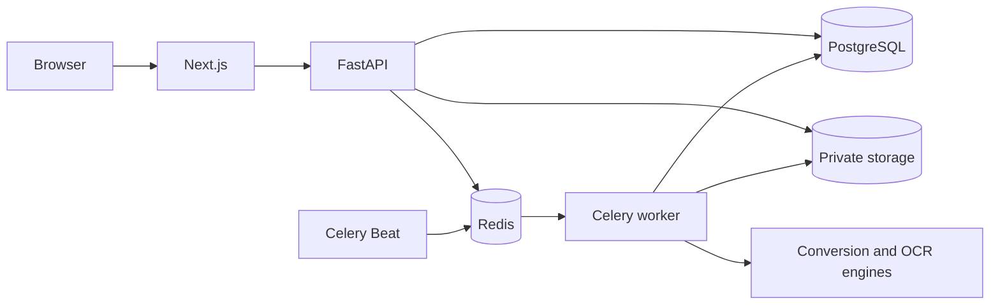

# Architecture and implementation plan

1. Establish shared contracts for uploads, page inspection, jobs, and document engines.
2. Build the editable DOCX pipeline, page-level OCR, quality checks, and original test fixtures.
3. Add database-backed jobs, Celery and Redis, staged file storage, owner-scoped APIs, and cleanup.
4. Connect the responsive Next.js application and the PDF toolkit to the shared job workflow.
5. Add account history, administration, and deployment infrastructure.
6. Verify the full stack with generated PDFs, scanned images, batch jobs, and authorized downloads.

## Service boundaries

The API authorizes uploads and jobs and stores their metadata. Workers execute document processing and put deliverables into private storage. Each job has its own status, warnings, and output. The browser connects to server-sent events for updates and can get the current status through REST. Scheduled maintenance expires file content according to deployment policy.

## Persistence and execution

Alembic tracks schema changes. PostgreSQL stores accounts, files, jobs, ordered job inputs, batches, usage counters, and runtime settings. File binaries live in a private volume or an S3-compatible bucket. Guest access uses a signed session cookie, and the server scopes file and job lookup to the owner.

The API creates job records before enqueueing an ID and attempt token. Scheduled recovery republishes attempts whose dispatch was interrupted. Workers claim queued attempts and update progress. Cancellation and retries invalidate old attempts, and only the active attempt can publish an output. Failed processing records a readable error. Completed outputs receive a new retention deadline. Redis supports coordination and rate limits while PostgreSQL remains the authority for job state.

The frontend uses one workbench for all tools. Its Next.js route handler proxies multipart uploads, REST calls, event streams, and attachment downloads without exposing the internal API address. The conversion engine and toolkit use the same worker interface. Pricing describes the free service and future plan capabilities. Plans and usage limits can be extended independently of payment integration.
