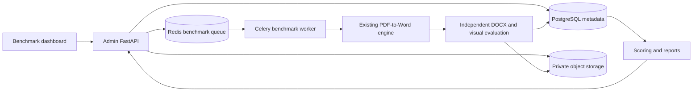

# PDF2DOCX-BENCH v1.0 architecture

The existing application uses Next.js and a same-origin API proxy, FastAPI and PostgreSQL, Redis and Celery, private local or S3 object storage, and a custom PyMuPDF and python-docx conversion pipeline. The worker ships Tesseract, OCRmyPDF, qpdf, and LibreOffice. Existing pytest cases cover generated digital and scanned documents, package integrity, toolkit operations, API ownership, expiry and live conversion. The baseline repository was on an unborn branch. A source archive was created before changing branches.

The original quality checks are useful for individual conversions. They sample rendered pages and word retention and do not record versioned ground truth, historical runs, independently reproducible scoring, or commercial references. The benchmark calls the production converter in isolated worker processes and evaluates its output separately. The public converter and its retention policy keep their existing entry points.

## Implementation plan

1. Define immutable dataset revisions, checksummed PDF objects, test-case expectations, and run/result contracts.
2. Generate the original synthetic corpus and expose its metadata and controlled uploads.
3. Measure editable content, package structure, page geometry, render differences, OCR and resource usage with the production converter.
4. Schedule bounded workers, persist case results, aggregate scores with critical failure gates, and support historical runs and failed-case reruns.
5. Expose admin-only reports and a dashboard with protected artifacts and manual reference uploads.
6. Migrate and test in Docker, execute measurable benchmarks, verify existing workflows, and record limitations.

